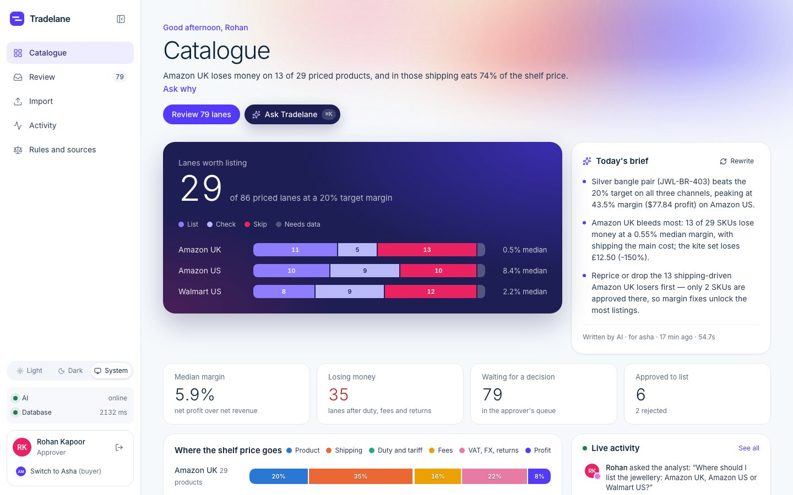
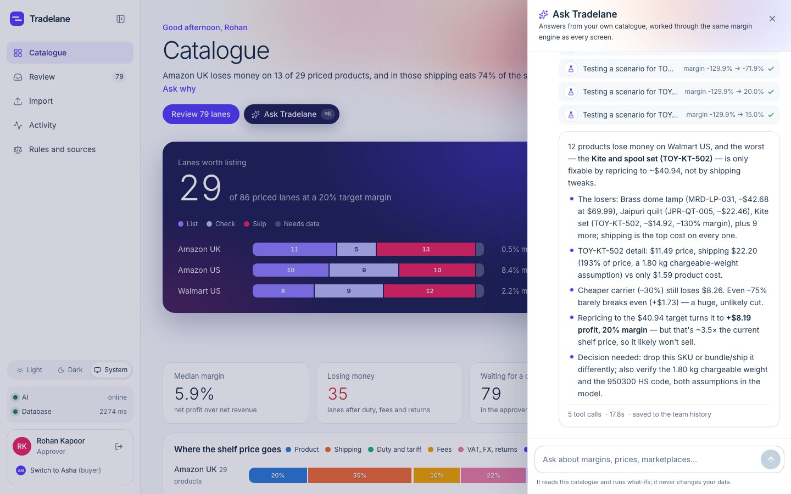
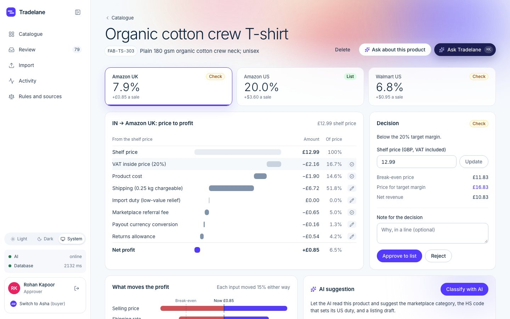
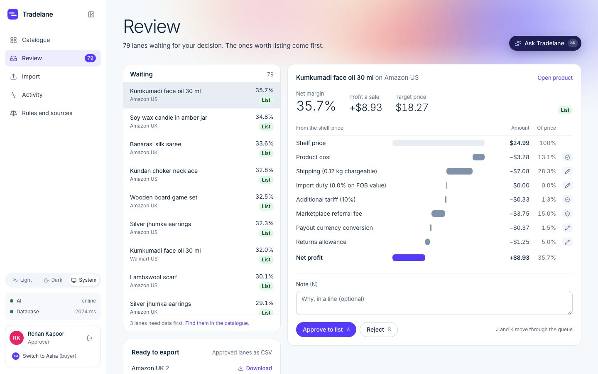
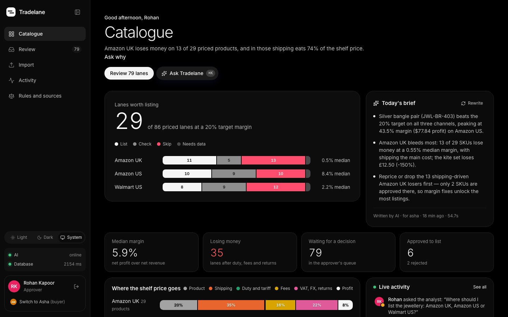
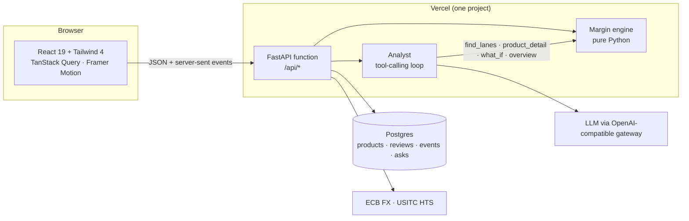

<div align="center">


# Tradelane

**Know where every product makes money.**

Landed cost for each supplier product on Amazon UK, Amazon US and Walmart US, worked out line by line:
shipping, duty, tariffs, VAT, marketplace fees and FX. AI does the repetitive work. A person makes the call.

[**Live demo**](https://tradelane-seven.vercel.app) &nbsp;·&nbsp; [How the numbers work](#how-a-margin-is-worked-out) &nbsp;·&nbsp; [Run it locally](#run-it-locally)


<br />



</div>

<br />

## The problem

A cross-border seller makes one decision before listing anything: **does this product make money in that country, on that marketplace, after everything?**

A rug that looks cheap at the supplier can lose money once it is shipped by volumetric weight, pays a 10% tariff on top of its duty, gives Amazon 15% of a VAT-inclusive price and loses a slice to currency conversion. Tradelane answers that question for a whole supplier sheet at once, and shows its working.

## What you can do in the demo

Sign in with one click as **Asha** (buyer) or **Rohan** (approver). Everything either of them does is saved with their name and shows up in the activity feed for both.

<table>
<tr>
<td width="50%" valign="top">

### Ask the analyst
Ask anything about the catalogue: *"Which products lose money on Walmart US, and what would fix the worst one?"* The analyst calls tools that run the real margin engine, including what-if scenarios on price, supplier cost and shipping, and you watch each step as it happens. Answers are saved for the team.

</td>
<td width="50%"></td>
</tr>
<tr>
<td width="50%"></td>
<td width="50%" valign="top">

### See where every penny goes
Each product shows its margin on every marketplace, the shelf price walked down to net profit, what moves the profit most (each input nudged 15% either way), and the break-even and target prices. Every number is tagged as a **fact** (with its source and the date it was checked), an **assumption** you can edit, an **AI suggestion**, or **missing**.

</td>
</tr>
<tr>
<td width="50%" valign="top">

### Decide, then export
Lanes worth listing come first in the review queue. Only the approver can approve or reject (keyboard: `A`, `R`, `J`/`K`), and each decision is stored with the exact numbers it was made on. Approved lanes export as a CSV per marketplace, with the AI's listing draft.

</td>
<td width="50%"></td>
</tr>
<tr>
<td width="50%"></td>
<td width="50%" valign="top">

### Light and dark
Follows the system setting, or pick one. The dark theme is pitch black and neutral, with its own chart colours checked for contrast and colour-blind separation.

Also in the box: AI classification of category, HS code and listing copy that you watch fill in row by row, a three-line AI brief of the whole catalogue, hover cards with each lane's cost breakdown, and a collapsible sidebar (`[`).

</td>
</tr>
</table>

## How a margin is worked out

For every product and every marketplace it can ship to:

```
net revenue   = shelf price − VAT inside it (UK 20%; US sales tax is the marketplace's)
landed cost   = supplier cost (converted at today's ECB rate)
              + shipping       base + rate × max(actual kg, L×W×H ÷ 5,000)
              + import duty    HTS / UK tariff rate × FOB (US) or CIF (UK) value
              + tariff         Section 301, 10% on goods from India and the UK (US only)
              + referral fee   per category, price bands or marginal tiers, with minimums
              + payout FX fee, returns allowance, advertising
net profit    = net revenue − landed cost
margin        = net profit ÷ net revenue
```

Break-even and target prices are solved by scanning then bisecting, because profit is a step function (fee bands, the £135 UK duty threshold). A lane is **List** when it clears the target margin with a confirmed category, **Check** when it makes money but not enough (or the category is still an AI guess), **Skip** when it loses money, and **Needs data** when a weight, cost or category is missing.

## The rules, as checked on 22 October 2026

| | Rule | Source |
|---|---|---|
| Fees | Amazon.com, Amazon.co.uk and Walmart Marketplace referral fees for 7 categories, with price bands, marginal jewellery tiers and minimum fees | [Amazon US](https://sell.amazon.com/pricing) · [Amazon UK](https://sell.amazon.co.uk/pricing) · [Walmart](https://marketplacelearn.walmart.com/guides/Policies%20&%20standards/Product%20listings/Referral-fee-schedule-for-contract-categories) |
| US duty | No de minimis (suspended for all countries). HTS column 1 rate, looked up live from the product's HS code | [USITC HTS](https://hts.usitc.gov/) |
| US tariff | Section 301: 10% on goods of India and the UK since 24 Jul 2026. The IEEPA tariffs ended with the Supreme Court ruling of 20 Feb 2026 | [91 FR 47318](https://www.federalregister.gov/documents/2026/07/28/2026-15181/notice-of-actions-in-section-301-investigations-of-acts-policies-and-practices-of-various-economies) |
| UK | 20% VAT collected by the marketplace; no customs duty on parcels up to £135 (relief ends by Oct 2028) | [GOV.UK](https://www.gov.uk/guidance/vat-and-overseas-goods-sold-to-customers-in-the-uk-using-online-marketplaces) |
| FX | European Central Bank reference rates, cached 12 hours, with saved fallbacks | [Frankfurter](https://api.frankfurter.dev) |
| Shipping | A sample parcel rate card per route. An assumption on purpose: it belongs to your carrier contract | Edit under *Rules* |

Two judgement calls worth knowing: Amazon UK's pages disagree on whether the fee base includes VAT, so Tradelane uses the higher reading; and when an HS code has only 6 digits, it takes the **highest** US rate under that heading and says so, so an imprecise code can only understate a margin, never flatter it.

## How it is built



- **The engine is pure.** `tradelane/engine.py` has no I/O at all, so every screen and the analyst run the same numbers, and it is tested with hand-calculated cases.
- **Evaluations are computed on read.** Change a rate, a price or a category and every screen updates; a review stores a snapshot of the numbers it was decided on.
- **The AI is boxed in.** It may only pick a category from a fixed list, its output is validated and retried once with the error fed back, and a category it suggests never lists a product until a person confirms it. The analyst reads; it never writes.
- **Built for serverless.** One product per classification request, a pooled database connection with a connect timeout, and low reasoning effort on multi-step answers (78 s down to about 20 s).

```
tradelane/engine.py     the margin engine: every figure carries its source
tradelane/rules.py      fees, duties, VAT, routes, each with a source URL and check date
tradelane/sources.py    live FX and US duty lookups, cached
tradelane/catalogue.py  the catalogue read through the engine, shared by the API and the analyst
tradelane/analyst.py    the analyst's tools and loop, streamed as server-sent events; the brief
tradelane/ai.py         classification: function calling, validated output, keyword fallback
tradelane/app.py        FastAPI: demo sign-in, roles, activity log, products, review, export
web/                    React + Vite + TypeScript + Tailwind 4
```

## Run it locally

```sh
uv venv .venv && uv pip install -p .venv -r requirements.txt -r requirements-dev.txt
cp .env.example .env              # optional: DATABASE_URL, GLM_API_KEY; empty means SQLite + keyword matching
.venv/bin/uvicorn tradelane.app:app --port 8000 --env-file .env

cd web && npm ci && npm run dev   # http://localhost:5173, /api is proxied to :8000
```

Sign in as Asha, open **Import** and load the 30-product sample: Indian and UK suppliers with realistic but made-up products, costs and prices.

| Variable | Default | |
|---|---|---|
| `DATABASE_URL` | SQLite file | Postgres connection string (use a pooled one) |
| `GLM_API_KEY` | none | Turns on the AI; without it, categories come from keyword matching |
| `GLM_BASE_URL` | `https://api.aicredits.in/v1` | Any OpenAI-compatible endpoint |
| `GLM_MODEL` | `z-ai/glm-5.3-flash` | |
| `SESSION_SECRET` | a demo value | Signs the demo sign-in cookie |

## Tests

```sh
.venv/bin/python -m pytest -q     # 26 tests: hand-calculated engine cases, API flows, roles, activity, analyst tools
node web/e2e/smoke.mjs            # a browser run-through of the whole flow
```

The browser test reloads the sample, so point it at a throwaway database: run the API with `DATABASE_URL=sqlite:////tmp/e2e.db` on port 8001, Vite with `API_PORT=8001` on port 5174, then `BASE_URL=http://localhost:5174 node web/e2e/smoke.mjs`.

## Deploy

One Vercel project serves the React build and runs FastAPI as a Python function under `/api` (see `vercel.json`). Set `DATABASE_URL`, `GLM_API_KEY` and `SESSION_SECRET` as environment variables.

## Not in this version

Publishing to marketplaces through their APIs, FBA and warehouse fees, US customs broker fees, itemised Section 301 exemptions, India–UK FTA rates, real accounts and live competitor prices. Each plugs into `rules.py` or `sources.py` without touching the engine.

<br />

<div align="center"><sub>Built by <a href="https://fazal-two.vercel.app">Fazal Singh</a>. Sample products; real fee schedules, tariffs and exchange rates.</sub></div>
